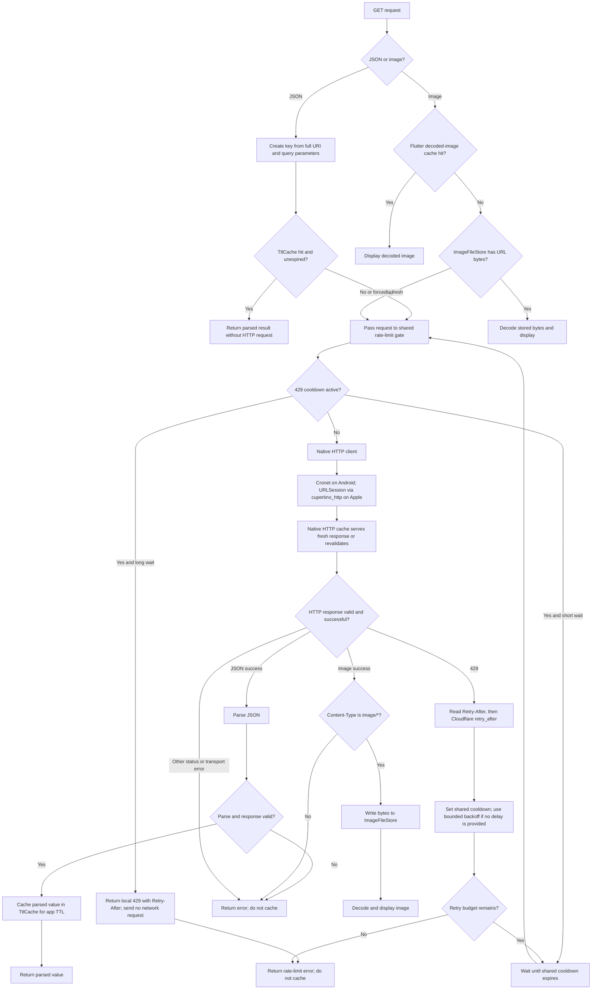

# HTTP caching and rate-limit strategy

This guide describes how to handle the JSON and avatar GET requests shown in
[`GET_request_logs.md`](GET_request_logs.md), while minimizing requests that
could trigger Cloudflare HTTP 429 (Error 1015). It uses the caching primitives
in `lib/cache/` and native HTTP clients on Android and Apple platforms.

## What the response headers mean

Both logged responses include:

```http
Cache-Control: public, max-age=7776000, immutable
```

`max-age=7776000` is 90 days, but the logged `Age` is already about 84–85
days. A native HTTP cache accounts for that age, leaving only about 5–6 days
of freshness in these examples. Once stale, it may revalidate with the
server using an ETag; revalidation still involves a request.

`immutable` tells caches not to revalidate a still-fresh response just because
it is requested again. It does not prevent eviction or make a native HTTP
cache permanent. The image file store can keep bytes longer, but only use
never-revalidate behavior for URLs known to identify immutable image content.

The 429 response documented in
[`error_1015_in_status_429.md`](error_1015_in_status_429.md) is `no-store`.
Never put an error response or a failed parse into either application cache.

## Request algorithm



### JSON responses

- Use the full request URI, including query parameters, as the cache key so
  different pages and searches do not collide.
- Put `TtlCache` above the HTTP client. Its cache hits then avoid the network
  entirely, even while a 429 cooldown is active.
- Cache successful parsed data only. If the API wraps failures in result
  values rather than throwing, use `cacheable` to reject those values.
- Pick a product-appropriate TTL (for example, 10–30 minutes for list/search
  results). A forced refresh should bypass the app TTL but still pass through
  the rate-limit gate and native HTTP cache.
- `TtlCache` coalesces concurrent loads for the same key and removes failures;
  retain those properties when wiring it into the API service.

### Image responses

- Check Flutter's decoded-image cache first, then `ImageFileStore` by URL.
- On a disk miss, fetch via the same shared client, validate status and
  `Content-Type: image/*`, then persist bytes only when the response includes
  the `immutable` cache directive. Do not store challenge pages, errors, or
  other non-image bodies.
- `ImageFileStore` coalesces concurrent downloads for the same URL. The
  app-managed file store is longer-lived than the native HTTP cache, which can
  evict entries or revalidate after their freshness expires.
- Use `CachedHttpImage` rather than `NetworkImage`/`Image.network` when the
  image must use the injected client and file store. Resize avatars before
  decoding when the display size is much smaller than the source image.
- The current file store uses `dart:io`, so it is for native platforms, not
  Flutter web.

### Avoiding repeated 429 responses

- Apply one shared cooldown to all requests to this API, not one independent
  timer per screen or request. Requests already in local caches should still
  be returned during the cooldown. The client waits only for short cooldowns;
  for longer ones it returns a local 429 with the remaining `Retry-After`
  instead of leaving a request queued to fire later.
- On 429, prefer the `Retry-After` response header; if absent, use the
  Cloudflare problem-details `retry_after` value. If neither is available,
  use bounded exponential backoff (with jitter) rather than immediate retries.
- Bound the retry count. After the budget is exhausted, return the rate-limit
  error to the caller and do not retry in a tight loop.
- Keep failed responses out of the JSON TTL and image file caches. The native
  cache also follows the server's `no-store` directive for the 429 response.
- Avoid unnecessary calls: reuse cached pages/results, debounce search input,
  and do not fetch the same page repeatedly while a request is already in
  flight.

## Native HTTP clients

Create one shared `http.Client` and inject it into the REST API and image file
store. Use Cronet on Android and URLSession via `cupertino_http` on iOS/macOS:

```dart
http.Client createPlatformHttpClient() {
  if (Platform.isAndroid) {
    return CronetClient.fromCronetEngine(
      CronetEngine.build(
        cacheMode: CacheMode.disk,
        cacheMaxSize: 128 << 20,
      ),
    );
  }

  if (Platform.isIOS || Platform.isMacOS) {
    final config = URLSessionConfiguration.defaultSessionConfiguration()
      ..cache = URLCache.withCapacity(
        memoryCapacity: 8 << 20,
        diskCapacity: 128 << 20,
      );
    return CupertinoClient.fromSessionConfiguration(config);
  }

  return IOClient();
}
```

Use URLSession's default (persistent) configuration, not the ephemeral one.
Build one Cronet engine and share it. Leave `Accept-Encoding` to the native
stack; do not set it manually.

## Wiring note

`lib/cache/` contains useful primitives: `TtlCache`, `ImageFileStore`, and
`CachedHttpImage`. They only provide the described behavior when wired into
the REST service and image widgets. Route API and image misses through the
same rate-limit-aware client; do not use `NetworkImage` for images that must
participate in this cache and rate-limit flow.
